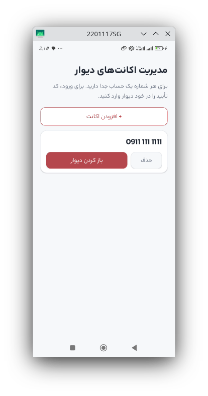
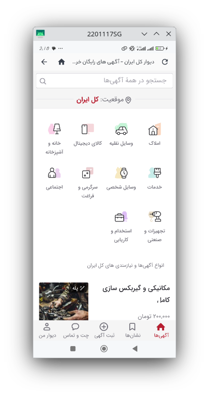

# دیوار پلاس · Divar +

**یک اپ سبک برای مدیریت همزمان چند آکانت دیوار**

[⬇️ دانلود آخرین نسخه](../../releases/download/latest/divar-plus.apk)

---

## 💡 دیوار پلاس چیست؟

اگر بیش از یک شمارهٔ دیوار دارید (شخصی، کاری، فروشگاه)، مجبورید مدام از حساب خارج شوید و دوباره وارد شوید.
**دیوار پلاس** این کار را ساده می‌کند: هر شماره را یک بار اضافه می‌کنید و برای هر حساب یک سشن مرورگر جداگانه ساخته می‌شود.

## ✨ امکانات

| | |
|---|---|
| 👥 **چند حساب مستقل** | هر شماره محیط جداگانه‌ای دارد و اطلاعات حساب‌ها هرگز با هم قاطی نمی‌شود. |
| 🔐 **ورود امن و رسمی** | ورود و کد تأیید فقط در خود سایت دیوار انجام می‌شود؛ اپ چیزی از آن را نمی‌خواند یا ذخیره نمی‌کند. |
| 🔔 **اعلان پیام جدید** | وقتی کاربری برایتان پیام بفرستد اعلان می‌گیرید و روی کارت همان حساب «پیام جدید» نمایش داده می‌شود. پیام‌های «پستچی دیوار» نادیده گرفته می‌شوند. |
| 🖼️ **ثبت آگهی با عکس** | انتخاب تصویر از گالری، بدون نیاز به دسترسی کامل به حافظه. |
| 🎨 **رابط فارسی** | طراحی راست‌به‌چین با فونت «آراد»، سازگار با بریدگی صفحه و نوار سیستم. |
| 🗑️ **حذف کامل** | با حذف یک حساب، تمام اطلاعات و نشست آن هم از گوشی پاک می‌شود. |

## 🖼️ تصاویر

| فهرست حساب‌ها | مرور دیوار | 
|:---:|:---:|
|  |  

## 📲 نصب

1. آخرین فایل **APK** را از بخش [Releases](../../releases/latest) دانلود کنید.
2. فایل را روی گوشی باز کنید و در صورت پرسیدن، نصب از منبع ناشناس را برای مرورگر یا مدیر فایل مجاز کنید.
3. برنامه را اجرا و اجازهٔ اعلان‌ها را بدهید.

**نیازمندی‌ها:** اندروید ۶ یا بالاتر

## 🚀 شروع سریع

1. روی **«+ افزودن اکانت»** بزنید و شمارهٔ موبایل را وارد کنید.
2. در صفحهٔ دیوار که باز می‌شود، با کد تأیید وارد شوید.
3. از این به بعد، حساب شما در فهرست است و با «باز کردن دیوار» مستقیم وارد می‌شوید.

## 🔒 حریم خصوصی

- شمارهٔ موبایل فقط برای نام‌گذاری حساب در فهرست و فقط روی گوشی شما ذخیره می‌شود.
- رمز یا کد تأیید دریافت، ذخیره یا ارسال نمی‌شود.
- متن پیام‌ها ذخیره نمی‌شود؛ برای تشخیص پیام تازه فقط یک اثر انگشت یک‌طرفه (هش) از هر گفتگو نگه داشته می‌شود.
- هیچ سرور واسطه‌ای وجود ندارد و اپ مستقیم به سایت رسمی دیوار وصل می‌شود.

## ⚠️ محدودیت‌ها

- اعلان‌ها هر **۱۵ دقیقه** (کمترین زمان مجاز اندروید) بررسی می‌شوند و لحظه‌ای نیستند. محدودیت‌های باتری برخی گوشی‌ها هم ممکن است آن را عقب بیندازد.
- اعلان‌ها آزمایشی هستند و با تغییر ظاهر سایت دیوار ممکن است نیاز به به‌روزرسانی داشته باشند.
- اگر گوشی از قابلیت چندحسابی WebView پشتیبانی نکند، اپ از شما می‌خواهد WebView را به‌روز کنید.

## 🛠️ ساخت از سورس

پروژه را در Android Studio باز کنید (JDK 17 و Android SDK 35) و **Run** کنید.

## 📄 توضیحات حقوقی

این پروژه **غیررسمی** است و هیچ ارتباطی با شرکت دیوار ندارد. «دیوار» نام و نشان متعلق به صاحبان آن است. اپ فقط وب‌سایت رسمی را نمایش می‌دهد و از API مخفی یا ابزار خودکار انتشار آگهی استفاده نمی‌کند.
فونت «آراد» تحت مجوز [SIL OFL](app/src/main/assets/fonts/OFL.txt) منتشر شده است.

